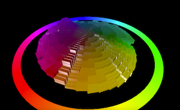

# Munsell-Color-Space-Explorer

<!-- SUMMARY:START generated from workspace-linkedin-profile/Projects.json by scripts/build_readme_header.py; edit there -->
<a href="https://sbecker11.github.io/munsell-color-space-explorer/" target="_blank" rel="noopener noreferrer"></a>

Interactive 3D Munsell color-chip explorer.

**RunMe:** [https://sbecker11.github.io/munsell-color-space-explorer/](https://sbecker11.github.io/munsell-color-space-explorer/)

**Skills:** 3D Data Visualization · Computer Graphics · Color Science (Munsell Color System) · Three.js · JavaScript · HTML · Vite · Front-End Development · Babel · Jest · GitHub Pages · Automated Software Testing (JUnit/Jest/Vitest/PyTest)
<!-- SUMMARY:END -->

See related project <a href="https://github.com/sbecker11/workspace-munsell">workspace-munsell</a>

##  How to build this app
1. `npm install`
2. `npm run build`
3. `npm run dev`

## To deploy to GitHub Pages

From this repository's root:

```bash
npm install
npm run deploy
```

`npm run deploy` builds the `dist` folder and publishes it to the `gh-pages` branch. The live app is [https://sbecker11.github.io/munsell-color-space-explorer/](https://sbecker11.github.io/munsell-color-space-explorer/). GitHub Pages can take about a minute to show the new build.


