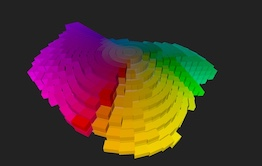

# workspace-rolodex

<!-- SUMMARY:START generated from workspace-linkedin-profile/Projects.json by scripts/build_readme_header.py; edit there -->

Interactive 3D Munsell color-chip visualization.

**RunMe:** [https://sbecker11.github.io/workspace-rolodex/](https://sbecker11.github.io/workspace-rolodex/)\
**RunMe:** [https://sbecker11.github.io/munsell-space/](https://sbecker11.github.io/munsell-space/)

**Skills:** 3D Data Visualization · Computer Graphics · Color Science (Munsell Color System) · Three.js · JavaScript · HTML · Vite · Front-End Development · Babel · Jest · GitHub Pages · Automated Software Testing (JUnit/Jest/Vitest/PyTest)
<!-- SUMMARY:END -->

<a href="https://sbecker11.github.io/workspace-rolodex/">Here's </a> my Munsell Color Chips in 3-D

## See my related project <a href="https://github.com/sbecker11/workspace-munsell">workspace-munsell</a>

##  How to build this app
1. `npm install`
2. `npm run build`
3. `npm run dev`

## To deploy to github pages
1. `npm run predeploy`
2. `npm run deploy`

